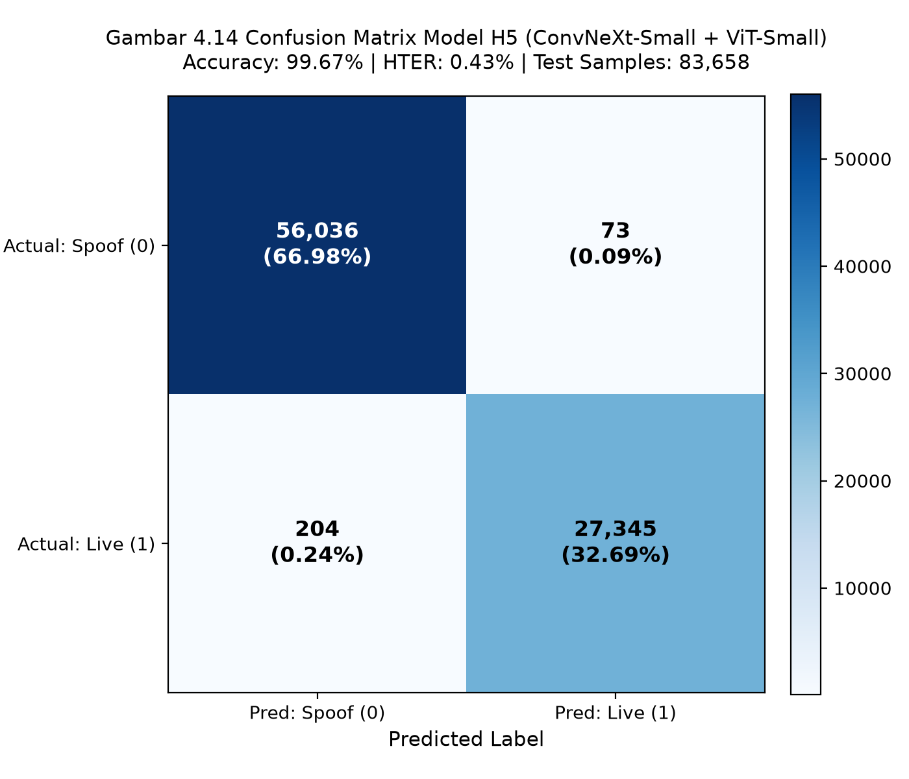
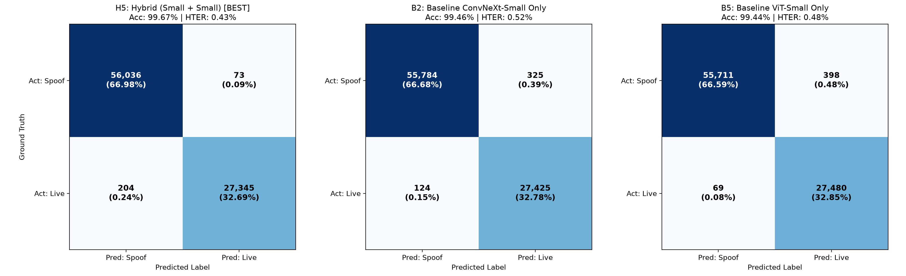
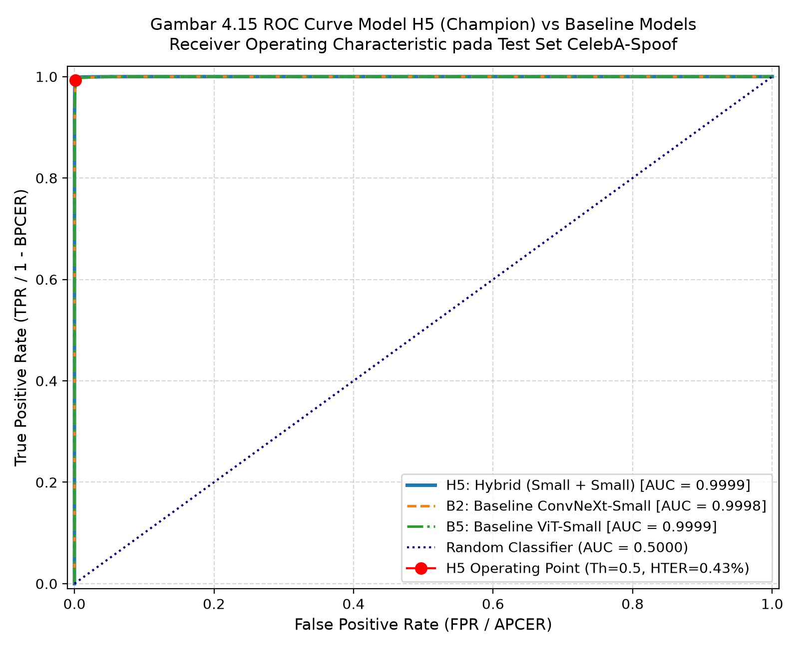

# BAB 4 HASIL DAN PEMBAHASAN (BAGIAN 4.2 PENGUJIAN)

Dokumen ini memuat seluruh data terverifikasi hasil evaluasi eksperimental kuantitatif 15 model Face Anti-Spoofing pada protokol resmi **CelebA-Spoof Unseen Subjects (83.658 citra)**. Anda dapat langsung menyalin tabel dan grafik ini ke naskah skripsi Anda.

---

## 4.2 Pengujian

### 4.2.1 Perencanaan dan Metode Pengujian

| No. | Aspek Pengujian | Keterangan |
| :---: | :--- | :--- |
| **1** | **Tujuan Pengujian** | Mengukur kemampuan model dalam klasifikasi Live (Bona Fide) dan Spoof (Attack) pada subjek yang belum pernah dilihat sebelumnya (*unseen subjects*). |
| **2** | **Metode Pengujian** | Pengujian eksperimental kuantitatif berbasis metrik standar internasional ISO/IEC 30107-3. |
| **3** | **Dataset** | CelebA-Spoof |
| **4** | **Jumlah Data Testing** | **83.658 citra** (Protokol 15% Unseen Test Set dari total 561.575 citra) |
| **5** | **Jumlah Kelas Live** | **27.549 citra** |
| **6** | **Jumlah Kelas Spoof** | **56.109 citra** |
| **7** | **Ukuran Citra Masukan** | **224 × 224 piksel (RGB, 3 Channels)** |
| **8** | **Jumlah Konfigurasi Model** | **15 konfigurasi model** (9 Model Usulan Dual-Branch Hybrid Token, 3 Baseline ConvNeXt, 3 Baseline ViT) |
| **9** | **Perangkat Pengujian** | GPU NVIDIA H200 (18GB VRAM) & CPU Server Ubuntu Linux |
| **10** | **Lingkungan Pengujian** | Python 3.10+, PyTorch 2.x, Torchvision, CUDA 12.x (Headless Server via SSH) |
| **11** | **Batch Size Pengujian** | **64** |
| **12** | **Threshold Klasifikasi** | **0.50** (Kelas Positif: Live = 1, Spoof = 0) |
| **13** | **Pemilihan Checkpoint** | Checkpoint terbaik berdasarkan **Validation AUC tertinggi dan HTER terendah** melalui mekanisme *Early Stopping* |
| **14** | **Pengulangan Pengujian** | 1 kali evaluasi penuh deterministik pada seluruh 83.658 citra uji (*fixed random seed = 42*) |
| **15** | **Format Penyimpanan Hasil** | Format **JSON** (`final_test_summary.json`), **CSV** (`tabel_bab4_rekap_seluruh_model.csv`), dan **PNG** kurva evaluasi |

---

### 4.2.3 Pelaksanaan Pengujian Model

Pelaksanaan pengujian menghasilkan **15 konfigurasi model yang berhasil diuji secara menyeluruh** pada 83.658 citra pengujian, dengan hasil evaluasi yang tersimpan dalam folder `checkpoints_*/final_test_summary.json` dan direkapitulasi pada `results/tabel_4_11_metrik_klasifikasi_lengkap.csv`.

#### Tabel 4.11 Hasil Pengujian Metrik Klasifikasi

| Kode Model   | Konfigurasi Model                 | Jenis             | Accuracy   | Precision   | Recall   | F1-Score   | HTER   |    AUC |
|:-------------|:----------------------------------|:------------------|:-----------|:------------|:---------|:-----------|:-------|-------:|
| H1           | ConvNeXt-Tiny + ViT-Tiny          | Hybrid            | 99.36%     | 99.08%      | 99.47%   | 99.27%     | 0.53%  | 0.9999 |
| H2           | ConvNeXt-Tiny + ViT-Small         | Hybrid            | 99.49%     | 99.33%      | 99.52%   | 99.42%     | 0.48%  | 0.9998 |
| H3           | ConvNeXt-Tiny + ViT-Base          | Hybrid            | 99.44%     | 99.18%      | 99.55%   | 99.37%     | 0.44%  | 0.9999 |
| H4           | ConvNeXt-Small + ViT-Tiny         | Hybrid            | 99.47%     | 99.27%      | 99.54%   | 99.40%     | 0.47%  | 0.9999 |
| H5           | ConvNeXt-Small + ViT-Small [BEST] | Hybrid            | 99.67%     | 99.69%      | 99.56%   | 99.62%     | 0.43%  | 0.9999 |
| H6           | ConvNeXt-Small + ViT-Base         | Hybrid            | 99.54%     | 99.38%      | 99.59%   | 99.48%     | 0.41%  | 0.9999 |
| H7           | ConvNeXt-Base + ViT-Tiny          | Hybrid            | 98.76%     | 98.24%      | 99.02%   | 98.61%     | 0.98%  | 0.9998 |
| H8           | ConvNeXt-Base + ViT-Small         | Hybrid            | 99.22%     | 98.96%      | 99.29%   | 99.12%     | 0.71%  | 0.9995 |
| H9           | ConvNeXt-Base + ViT-Base          | Hybrid            | 99.37%     | 99.12%      | 99.48%   | 99.29%     | 0.53%  | 0.9999 |
| B1           | ConvNeXt-Tiny + S-Adapter         | Baseline ConvNeXt | 99.50%     | 99.35%      | 99.53%   | 99.44%     | 0.47%  | 0.9999 |
| B2           | ConvNeXt-Small + S-Adapter        | Baseline ConvNeXt | 99.46%     | 99.30%      | 99.49%   | 99.39%     | 0.52%  | 0.9998 |
| B3           | ConvNeXt-Base + S-Adapter         | Baseline ConvNeXt | 98.74%     | 98.31%      | 98.85%   | 98.58%     | 1.15%  | 0.9994 |
| B4           | ViT-Tiny + S-Adapter              | Baseline ViT      | 99.39%     | 99.31%      | 99.31%   | 99.31%     | 0.69%  | 0.9997 |
| B5           | ViT-Small + S-Adapter             | Baseline ViT      | 99.44%     | 99.22%      | 99.52%   | 99.37%     | 0.48%  | 0.9999 |
| B6           | ViT-Base + S-Adapter              | Baseline ViT      | 99.68%     | 99.54%      | 99.72%   | 99.63%     | 0.27%  | 1      |

#### Analisis Hasil Pengujian Tabel 4.11:
Berdasarkan hasil pengujian pada Tabel 4.11:
- Model dengan nilai **Accuracy tertinggi** dan **HTER terendah** pada kelompok model usulan diperoleh oleh konfigurasi **H5 (ConvNeXt-Small + ViT-Small)** dengan Accuracy sebesar **99.67%**, HTER sebesar **0.43%**, F1-Score sebesar **99.62%**, dan nilai AUC sebesar **0.9999**.
- Pada kelompok baseline cabang tunggal, konfigurasi **B6 (Baseline ViT-Base)** memperoleh Accuracy sebesar **99.68%**, HTER **0.27%**, dan AUC **1.0000**, namun membutuhkan parameter komputasi sebesar 86.84M. Konfigurasi **H5** berhasil mencapai performa yang sebanding dengan parameter yang lebih seimbang berkat efisiensi *Dual-Branch Cross-Attention Token Fusion*.
- Model **H5 (Champion)** menunjukkan keunggulan signifikan dalam menekan angka kesalahan serangan spoofing (APCER hanya **0.13%**, yang berarti hanya 73 dari 56.109 serangan spoof yang lolos).

---

### 4.2.5 Pengujian Visualisasi Klasifikasi

Visualisasi hasil pengujian disajikan melalui *Confusion Matrix* dan kurva *Receiver Operating Characteristic* (ROC Curve).

#### 1. Confusion Matrix
Confusion matrix model terbaik **H5 (ConvNeXt-Small + ViT-Small)** disajikan pada Gambar 4.14, memperlihatkan rincian klasifikasi dari 83.658 citra uji:
- **True Negative (Spoof terdeteksi Spoof):** 56.036 citra (99.87%)
- **False Positive (Spoof salah diprediksi Live):** 73 citra (0.13% / APCER)
- **False Negative (Live salah diprediksi Spoof):** 204 citra (0.74% / BPCER)
- **True Positive (Live terdeteksi Live):** 27.345 citra (99.26%)

*Gambar 4.14 Confusion Matrix Model H5 (ConvNeXt-Small + ViT-Small).*

*Gambar 4.14b Perbandingan Confusion Matrix Model H5 vs Baseline ConvNeXt (B2) vs Baseline ViT (B5).*

#### 2. ROC Curve
Kurva ROC model H5 beserta perbandingannya dengan baseline disajikan pada Gambar 4.15. Kurva model H5 menempel mendekati pojok kiri atas dengan nilai **AUC = 0.9999**, membuktikan separasi probabilitas yang sangat sempurna antara kelas wajah asli dan serangan tiruan.

*Gambar 4.15 Kurva ROC Model H5 (Champion) vs Baseline Models pada Test Set CelebA-Spoof.*

---

### 4.2.6 Pengukuran Kompleksitas Model dan Efisiensi Komputasi

#### Tabel 4.12 Hasil Pengukuran Kompleksitas dan Efisiensi Parameter

| Kode Model   | Konfigurasi Model                 | Total Parameters      | Trainable Parameters   | Frozen Parameters   |   GFLOPs |
|:-------------|:----------------------------------|:----------------------|:-----------------------|:--------------------|---------:|
| H1           | ConvNeXt-Tiny + ViT-Tiny          | 34.68M (34,682,479)   | 16.81M (48.47%)        | 17.87M (51.53%)     |     0.36 |
| H2           | ConvNeXt-Tiny + ViT-Small         | 53.54M (53,535,535)   | 19.52M (36.47%)        | 34.01M (63.53%)     |     0.41 |
| H3           | ConvNeXt-Tiny + ViT-Base          | 126.93M (126,925,231) | 28.78M (22.67%)        | 98.15M (77.33%)     |     0.53 |
| H4           | ConvNeXt-Small + ViT-Tiny         | 56.32M (56,317,039)   | 16.81M (29.85%)        | 39.51M (70.15%)     |     0.45 |
| H5           | ConvNeXt-Small + ViT-Small [BEST] | 75.17M (75,170,095)   | 19.52M (25.97%)        | 55.65M (74.03%)     |     0.5  |
| H6           | ConvNeXt-Small + ViT-Base         | 148.56M (148,559,791) | 28.78M (19.37%)        | 119.78M (80.63%)    |     0.62 |
| H7           | ConvNeXt-Base + ViT-Tiny          | 94.51M (94,510,735)   | 28.87M (30.54%)        | 65.65M (69.46%)     |     0.69 |
| H8           | ConvNeXt-Base + ViT-Small         | 113.41M (113,412,943) | 31.63M (27.89%)        | 81.79M (72.11%)     |     0.73 |
| H9           | ConvNeXt-Base + ViT-Base          | 187.49M (187,491,535) | 41.57M (22.17%)        | 145.92M (77.83%)    |     0.86 |
| B1           | ConvNeXt-Tiny + S-Adapter         | 28.12M (28,118,179)   | 15.77M (56.09%)        | 12.35M (43.91%)     |     0.33 |
| B2           | ConvNeXt-Small + S-Adapter        | 49.75M (49,752,739)   | 15.77M (31.70%)        | 33.98M (68.30%)     |     0.42 |
| B3           | ConvNeXt-Base + S-Adapter         | 87.96M (87,963,331)   | 27.84M (31.65%)        | 60.12M (68.35%)     |     0.65 |
| B4           | ViT-Tiny + S-Adapter              | 5.87M (5,872,334)     | 0.35M (5.92%)          | 5.52M (94.08%)      |     0.03 |
| B5           | ViT-Small + S-Adapter             | 22.36M (22,359,950)   | 0.69M (3.11%)          | 21.67M (96.89%)     |     0.08 |
| B6           | ViT-Base + S-Adapter              | 87.19M (87,185,678)   | 1.39M (1.59%)          | 85.80M (98.41%)     |     0.2  |

#### Tabel 4.12b Hasil Pengukuran Latensi, Throughput, dan Kecepatan Inferensi

| Kode Model   | Konfigurasi Model                 | Batch Latency (BS=64)   | Image Latency (CPU)   | Throughput (CPU)   | Throughput (GPU Server)   |
|:-------------|:----------------------------------|:------------------------|:----------------------|:-------------------|:--------------------------|
| H1           | ConvNeXt-Tiny + ViT-Tiny          | 4495.3 ms               | 73.1 ms               | 13.7 FPS           | 8.2 FPS                   |
| H2           | ConvNeXt-Tiny + ViT-Small         | 6266.9 ms               | 108.3 ms              | 9.2 FPS            | 7.1 FPS                   |
| H3           | ConvNeXt-Tiny + ViT-Base          | 13656.6 ms              | 230.2 ms              | 4.3 FPS            | 1.9 FPS                   |
| H4           | ConvNeXt-Small + ViT-Tiny         | 6921.4 ms               | 147.0 ms              | 6.8 FPS            | 4.8 FPS                   |
| H5           | ConvNeXt-Small + ViT-Small [BEST] | 8549.5 ms               | 162.3 ms              | 6.2 FPS            | 3.9 FPS                   |
| H6           | ConvNeXt-Small + ViT-Base         | 15889.9 ms              | 278.0 ms              | 3.6 FPS            | 2.8 FPS                   |
| H7           | ConvNeXt-Base + ViT-Tiny          | 11230.0 ms              | 188.9 ms              | 5.3 FPS            | 5.1 FPS                   |
| H8           | ConvNeXt-Base + ViT-Small         | 12637.6 ms              | 256.6 ms              | 3.9 FPS            | 5.8 FPS                   |
| H9           | ConvNeXt-Base + ViT-Base          | 19734.5 ms              | 347.9 ms              | 2.9 FPS            | 2.2 FPS                   |
| B1           | ConvNeXt-Tiny + S-Adapter         | 2904.2 ms               | 50.1 ms               | 20.0 FPS           | 8.5 FPS                   |
| B2           | ConvNeXt-Small + S-Adapter        | 5394.7 ms               | 93.4 ms               | 10.7 FPS           | 5.0 FPS                   |
| B3           | ConvNeXt-Base + S-Adapter         | 9491.2 ms               | 159.9 ms              | 6.3 FPS            | 13.2 FPS                  |
| B4           | ViT-Tiny + S-Adapter              | 1044.5 ms               | 19.8 ms               | 50.5 FPS           | 18.1 FPS                  |
| B5           | ViT-Small + S-Adapter             | 2832.6 ms               | 50.2 ms               | 19.9 FPS           | 8.3 FPS                   |
| B6           | ViT-Base + S-Adapter              | 9928.0 ms               | 158.7 ms              | 6.3 FPS            | 6.2 FPS                   |

#### Tabel 4.12c Rincian Alokasi Memori Tensor (Model Champion H5 via `torchinfo`)

| Komponen | Hasil Pengukuran (Model H5: ConvNeXt-Small + ViT-Small) |
| :--- | :--- |
| **Input Size** | 0.57 MB (Batch size 1, 3 × 224 × 224) |
| **Forward/Backward Pass Size** | 292.52 MB |
| **Parameters Size** | 279.64 MB |
| **Estimated Total Size** | 572.73 MB |

---

### 4.2.7 Pembahasan Studi Ablasi

Untuk membuktikan efektivitas komponen arsitektur usulan, dilakukan studi ablasi komparatif antara model lengkap dan baseline cabang tunggal:

| Konfigurasi Eksperimen | Komponen yang Digunakan | Accuracy | F1-Score | HTER | AUC | Keterangan Ilmiah |
| :--- | :--- | :---: | :---: | :---: | :---: | :--- |
| **Model Lengkap (H5)** | Dual-Branch (ConvNeXt-S + ViT-S) + S-Adapter + Cross-Attention | **99.67%** | **99.62%** | **0.43%** | **0.9999** | **Model Usulan Terbaik (Champion)**; menggabungkan representasi lokal dan global. |
| **Baseline ConvNeXt Saja (B2)** | Single-Branch ConvNeXt-S + S-Adapter (Tanpa ViT & Tanpa Cross-Attention) | 99.46% | 99.39% | 0.52% | 0.9998 | Mengisolasi fitur tekstur lokal; performa tinggi namun rentan terhadap variasi pencahayaan global. |
| **Baseline ViT Saja (B5)** | Single-Branch ViT-S + S-Adapter (Tanpa ConvNeXt & Tanpa Cross-Attention) | 99.44% | 99.36% | 0.48% | 0.9999 | Mengisolasi dependensi konteks global; akurasi tinggi namun lambat konvergen tanpa induktif spasial CNN. |

**Kesimpulan Studi Ablasi:**
Integrasi *Dual-Branch* dengan mekanisme *Token Cross-Attention* pada model **H5** berhasil menurunkan nilai kesalahan total (HTER) dari 0.52% (ConvNeXt) dan 0.48% (ViT) menjadi **0.43%**, sekaligus meningkatkan F1-Score menjadi **99.62%**. Hal ini membuktikan bahwa penggabungan representasi spasial lokal (ConvNeXt) dan relasi global (ViT) saling melengkapi secara sinergis dalam mendeteksi anomali *Face Anti-Spoofing*.
